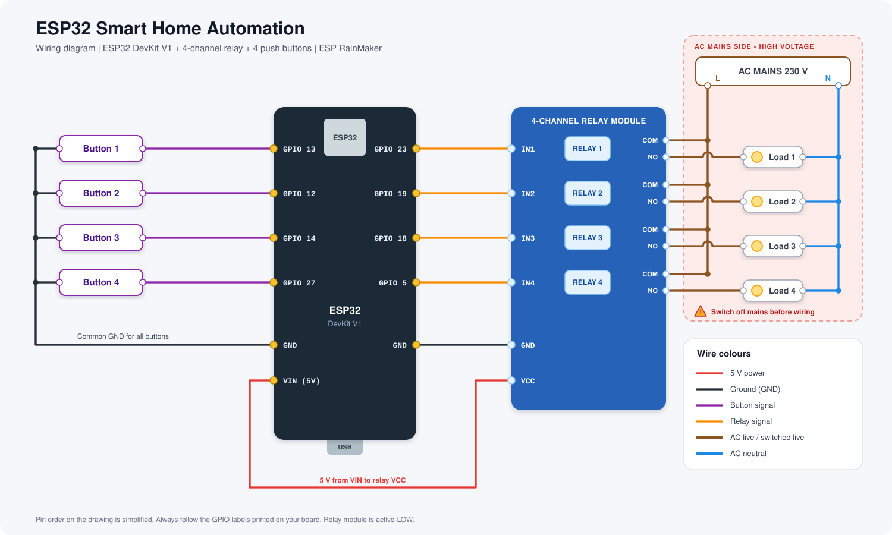

# Home Automation System (ESP32 + ESP RainMaker + Local Web Server)

An IoT-based 4-channel home automation system built on **ESP32** that lets you control appliances and lighting in real time via the **ESP RainMaker mobile app**, **voice assistants** (Google Assistant / Alexa via RainMaker), a **local web dashboard**, and **physical push buttons**, with automatic power-state restoration after a power cut.

## Key Features
- **Cloud & Voice Control:** Integrated with **ESP RainMaker** for remote mobile control and voice commands.
- **Local Web Server:** Hosts an on-device HTTP server (`port 80`) accessible directly over local Wi-Fi without internet dependency.
- **Physical Switch Support:** Debounced manual push-button control using the `AceButton` library, synced in real time with the cloud app.
- **Power-Outage State Restore:** Uses ESP32 Non-Volatile Storage (`Preferences` / NVS) to save and restore relay states on reboot when the restore flag is enabled.
- **BLE Provisioning & Factory Reset:** Easy Wi-Fi setup via Bluetooth Low Energy (`BLE`) and built-in `BOOT` button reset controls (3s for Wi-Fi reset, 10s for factory reset).

## Hardware Components
- **Microcontroller:** ESP32 Development Board
- **Actuator:** 4-Channel Relay Module (Active LOW)
- **Inputs:** 4x Tactile Push Buttons
- **Indicators:** Onboard Status LED (GPIO 2) & BOOT Reset Button (GPIO 0)

## GPIO Pinout Configuration

| Component | ESP32 GPIO Pin | Notes |
| :--- | :--- | :--- |
| **Relay 1** | `GPIO 23` | Active LOW |
| **Relay 2** | `GPIO 19` | Active LOW |
| **Relay 3** | `GPIO 18` | Active LOW |
| **Relay 4** | `GPIO 5` | Active LOW |
| **Button 1** | `GPIO 13` | Manual toggle for Relay 1 |
| **Button 2** | `GPIO 12` | Manual toggle for Relay 2 |
| **Button 3** | `GPIO 14` | Manual toggle for Relay 3 |
| **Button 4** | `GPIO 27` | Manual toggle for Relay 4 |
| **Status LED** | `GPIO 2` | Indicates state-restore mode |
| **Reset Button** | `GPIO 0` | Hold 3s: Wi-Fi reset / Hold 10s: Factory reset |

## Circuit & Wiring Diagram

## Libraries Required
- `RMaker` & `WiFiProv` (ESP32 Arduino Core - RainMaker)
- `Preferences` (ESP32 built-in NVS storage)
- `WebServer` & `WiFi` (ESP32 built-in networking)
- `AceButton` (by Brian T. Park)

## How to Set Up & Run
1. Open `home_automation_rainmaker.ino` in the **Arduino IDE** with the **ESP32 Board Package** installed.
2. Install the **AceButton** library via Arduino Library Manager.
3. Update your Wi-Fi credentials (`ssid` and `password`) or provision the board via Bluetooth using the **ESP RainMaker** mobile app (`POP: abcd1234`).
4. Select your ESP32 board and COM port, then click **Upload**.
5. Control your appliances via the RainMaker app, physical switches, or by visiting the ESP32's local IP address (`http://192.168.1.100`) in any browser on the same Wi-Fi network.
